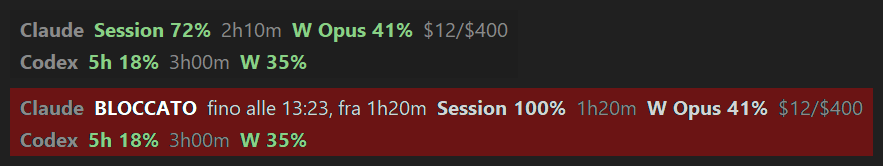
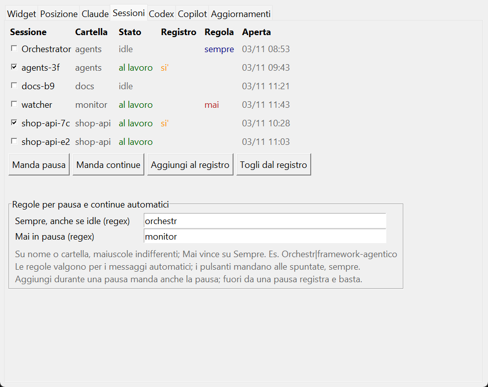
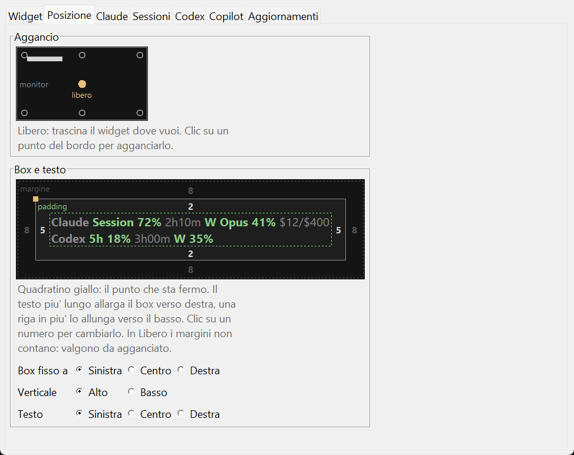
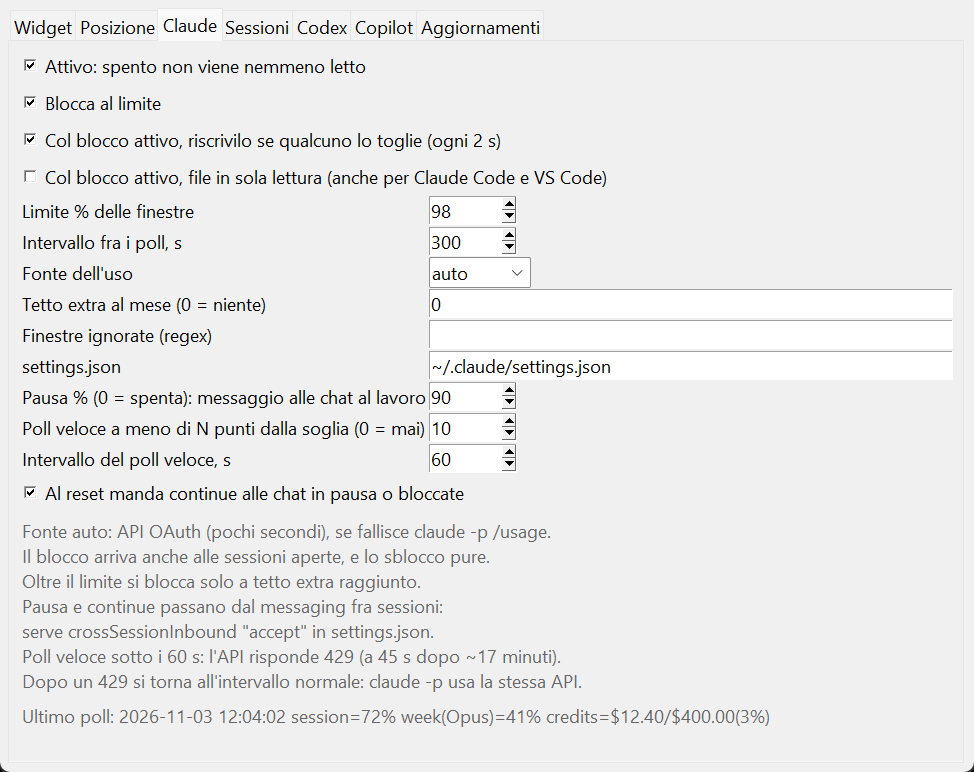

# usage-guard

Keeps Claude Code, Codex and GitHub Copilot inside the usage limits you choose, on Windows.
A small always-on-top widget shows the usage windows. Near the limit it pauses your Claude
Code sessions, and at the limit it blocks the tools until the window resets.



The interface is in Italian.

## What it does

- **Reads usage.**
  - Claude: the OAuth usage endpoint with Claude Code's own token, or `claude -p /usage` if that fails.
  - Codex: the Codex app-server of the VS Code extension.
  - Copilot: the quota cache of the Copilot CLI.
- **Pauses and resumes Claude Code sessions.** At the pause threshold, working sessions get a
  "finish this step and stop" message through cross-session messaging. After the reset, the same
  sessions get a "continue" message. Reopened sessions are followed by conversation id.
- **Blocks at the limit.** It writes an unreachable base URL into the tool's config:
  `ANTHROPIC_BASE_URL` in `~/.claude/settings.json`, `openai_base_url` for Codex, the Copilot URL
  overrides. It puts the previous value back at the reset. Open sessions follow the change without
  a restart.
- **Keeps the block in place.** While blocked, it checks the file every 2 s and rewrites the block
  if another program changes it. Optionally, it keeps the file read-only.
- **Warns about leaks.** If spend rises while the block is on, the widget shows
  `SPESA COL BLOCCO`: some client is not reading the blocked config.
- **Updates itself** from the GitHub releases, if you turn it on.

## Settings

Right-click the widget → **Impostazioni**.

**Sessioni** lists the open Claude Code sessions. It shows who will get the continue at the reset,
and has buttons to send pause or continue by hand. The rules decide which sessions always or never
get the automatic messages.



**Posizione** sets where the widget sits: free or docked to a screen edge. It also sets which
corner stays fixed when the text grows, and the margins and padding. Click a number to edit it.



**Claude** has the limits, the pause threshold, the polling intervals and the block options.



## Requirements

- Windows 10 or 11, Python 3.11 or later (tested on 3.13).
- Claude Code logged in with a claude.ai subscription.
- For pause and continue: `"crossSessionInbound": "accept"` in `~/.claude/settings.json`.
- Optional: `pip install truststore`, to check certificates through the Windows certificate store.
  You need it behind a network that inspects TLS.

## Install

1. Download `usage-guard.zip` from the [latest release](https://github.com/MassimilianoPili/usage-guard/releases/latest)
   and extract it, or clone the repository.
2. Install the copy that runs and updates itself:
   ```
   python usage_guard.py --install
   ```
   It goes to `%LOCALAPPDATA%\usage-guard`. A folder with `.git` is never updated.
3. Start the widget:
   ```
   python "%LOCALAPPDATA%\usage-guard\usage_guard.py"
   ```
   To start it at logon: right-click → **Avvia con Windows**.

## Command line

| Option | What it does |
|---|---|
| *(none)*, `--widget` | Opens the widget |
| `--loop`, `--once` | Polls in the terminal, continuously or once |
| `--status` | Shows usage, block and reset times |
| `--block`, `--unblock` | Blocks or unblocks by hand |
| `--pause`, `--resume [session ...]` | Sends pause or continue by hand |
| `--config` | Asks the main settings in the terminal |
| `--version`, `--check-update`, `--install [vX.Y.Z]` | Version and updates |

Config, state and log are in `~/.claude`: `usage-guard.json`, `usage-guard.state.json`,
`usage-guard.log`.

## Limits

- The block stops only clients that read the blocked config: Claude Code in the terminal and in
  VS Code. It does not stop claude.ai, the desktop app, or programs that start `claude` without
  your settings (`--setting-sources ""`).
  - While a block is on, the file `~/.claude/usage-guard.block` exists. Such programs can check it
    before they call the model.
- The usage endpoints are not documented and can change.

## Releases

`release.ps1 X.Y.Z` (in PowerShell 7) sets the version, tags and pushes. The GitHub workflow
publishes `usage-guard.zip` and its `.sha256`. Details and known issues: [RECIPE.md](RECIPE.md).
